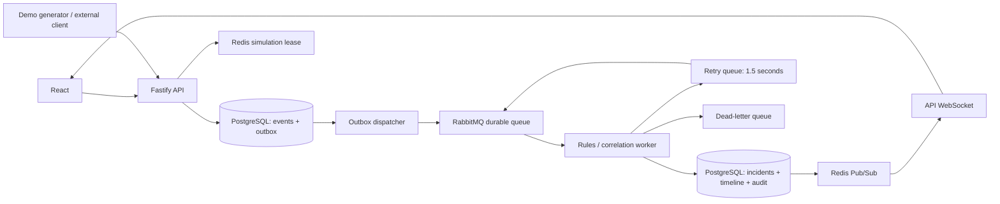

# Исполняемая архитектура Sentinel

## PostgreSQL

Миграции `server/db/migrations/` (`001`…`008`): `001_initial` — services, rules, incidents, audit_entries, monitoring_events, event_outbox, app_metadata и sequence incident_number; далее platform, AI (`ai_analyses`), evidence, notification lease/audit, timeline. Индексируемые поля — в колонках, остальная доменная проекция — JSONB (доверенный внутренний снимок; внешний ввод валидируется на границе API). Аудит — отдельные строки. Источник правды для timeline — таблица `incident_timeline` (`006`/`007`); в payload инцидента поле `timeline` при чтении гидратируется из этой таблицы и не считается отдельным SoT. Миграции защищены PostgreSQL advisory lock; применённые версии хранятся в schema_migrations.

Accept-транзакция фиксирует событие и outbox. Dispatcher сериализуется advisory lock между всеми процессами. Publisher confirm предшествует отметке published_at. Падение между publish и commit порождает дубликат, который безопасно отбрасывается worker.

Worker блокирует событие FOR UPDATE, проверяет processed_at, затем блокирует строку сервиса для сериализации корреляции. Строки открытых инцидентов этого сервиса также блокируются. Применение события — чистая функция: она обновляет только более новый sequence приёма, пересчитывает здоровье из отдельных сигналов и коррелирует алерт с открытым инцидентом. Корреляция — досягаемость влияния: сам сервис, то, от чего он зависит, и то, что зависит от него. Соседи через общую зависимость не сливаются. Это не доказательство причины. Advisory lock приёма, зависимостей, хранения и миграции считаются от `current_schema()`, чтобы один tenant не блокировал другой. Номер инцидента берётся из sequence только когда инцидент действительно создаётся. Метрики, incident state, timeline, audit и processed_at фиксируются одной транзакцией; ack выполняется после commit. Обновление оператором блокирует строку инцидента и проверяет version. Redis не участвует в обеспечении атомарности этих записей.

## RabbitMQ

Имена для namespace sentinel:

- topic exchange `sentinel.events.exchange`, routing key `event.received`;
- очередь `sentinel.events.process.v2` (quorum, single-active-consumer, prefetch 1);
- очередь `sentinel.events.retry.v2`: durable, TTL 1500ms, dead-letter обратно в event.received;
- очередь `sentinel.events.dead.v2` и exchange `sentinel.events.exchange.dead`.

Старые classic-очереди без суффикса `.v2` не удаляются. При старте их сообщения переносятся через соединение, которое вернул `amqp.connect`, после чего старые привязки снимаются. Канал AI закрывается отдельно и не закрывает это соединение.

В envelope передаётся eventId, payload берётся из PostgreSQL. Три повтора временной ошибки, затем DLQ. Публикация в DLQ идёт в `exchange.dead` / `dead`; прямая публикация в очередь через default exchange для этого пути не используется. Retry по-прежнему публикуется в retry queue, чтобы сработал её TTL. Обе публикации mandatory: немаршрутизируемое сообщение не подтверждает outbox. Retry-публикация подтверждается до ack исходного сообщения. При потере соединения unacked deliveries возвращаются в очередь. `close` увеличивает поколение соединения и дожидается текущего `connect`, чтобы позднее соединение не осталось активным. Retry может изменить порядок доставки. В local-режиме проекция сравнивает sequence приёма и не заменяет метрику более старым наблюдением. В event-time режиме побеждает более поздний timestamp события; sequence используется только если время совпало. Пока инцидент сервиса открыт и здоровье остаётся degraded или outage, старое нарушение метрики может добавить алерт. После закрытия инцидента такое наблюдение новый инцидент не создаёт. Наблюдение типа health назад не применяется. Если публикация в DLQ не подтвердилась, сообщение паркуется в retry queue и подтверждается только после этого. Статус `failed` пишется после подтверждения DLQ. Если запись статуса не удалась, сообщение паркуется в retry queue с пометкой status-only и подтверждается: повторная доставка записывает статус и не публикует ещё одну копию в DLQ. Если парковка тоже не подтвердилась, сообщение возвращается в рабочую очередь через 1.5 секунды и не снимается брокером. Та же пауза стоит на неудачной retry-публикации. Один RabbitMQ-узел и classic DLX в Compose не обеспечивают HA.

## Redis

Канал `sentinel:state.changed` доставляет invalidation другим процессам. Сообщение содержит origin, marker, scopes и необязательный incident id. Процесс игнорирует собственный origin, поэтому локальный WebSocket и Redis не создают два сигнала от одного изменения. В Redis не хранится авторитетное состояние инцидентов. Сводка и открытая карточка инцидента опрашиваются каждые 15 секунд; reconnect обновляет все запросы. Lease `sentinel:simulation-lock` предотвращает параллельные демонстрации: SET NX PX, сравнение token в Lua, продление перед шагом, TTL 60 секунд. Это координация симулятора, не fencing для бизнес-операций.

## Процессы

В dev `EMBEDDED_WORKER` по умолчанию `true`: процесс API принимает HTTP и сам запускает consumer, outbox dispatcher, operations scheduler и AI publisher. `EMBEDDED_WORKER=false` оставляет API только HTTP, миграции, Redis и соединение RabbitMQ. Consumer и фоновые циклы тогда не стартуют; их выполняет `npm run worker`, который всегда включает этот режим. Compose поднимает API и worker отдельными контейнерами. Health API без consumer остаётся `degraded`: готовность очереди смотрит `/health` worker. Замолчавший поток закрывает event-time окно отдельным тиком worker, без новых метрик. API и worker пока используют одну PostgreSQL-БД; выделение отдельных bounded contexts и database-per-service — следующий этап.

`/api/live` показывает жизнь процесса, `/api/health` — зависимости, consumer и прогресс outbox. Отдельный worker публикует тот же отчёт на `/health`. Если RabbitMQ временно упал, API может принимать события в durable outbox при исправной PostgreSQL, но readiness будет degraded. Потеря Redis не отменяет уже зафиксированные изменения; симулятор при потере lease останавливает следующие шаги. UI берёт краткий `/api/summary`: открытые инциденты без timeline и число закрытых. Список, фильтр Active/Resolved и поиск идут через `/api/incidents`, поэтому открытый инцидент не прячется за первой страницей истории. Timeline открытого инцидента запрашивается отдельно. Журнал обновляется с тем же интервалом, что и сводка.
